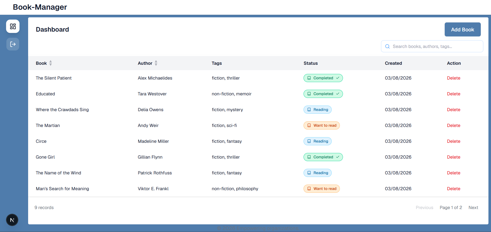
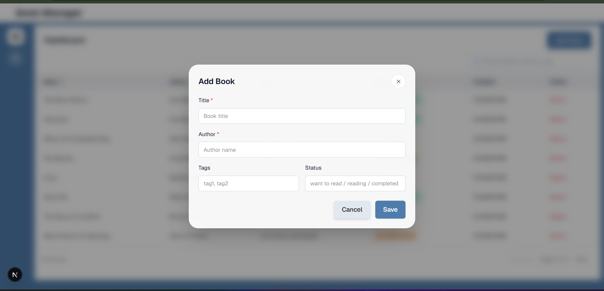
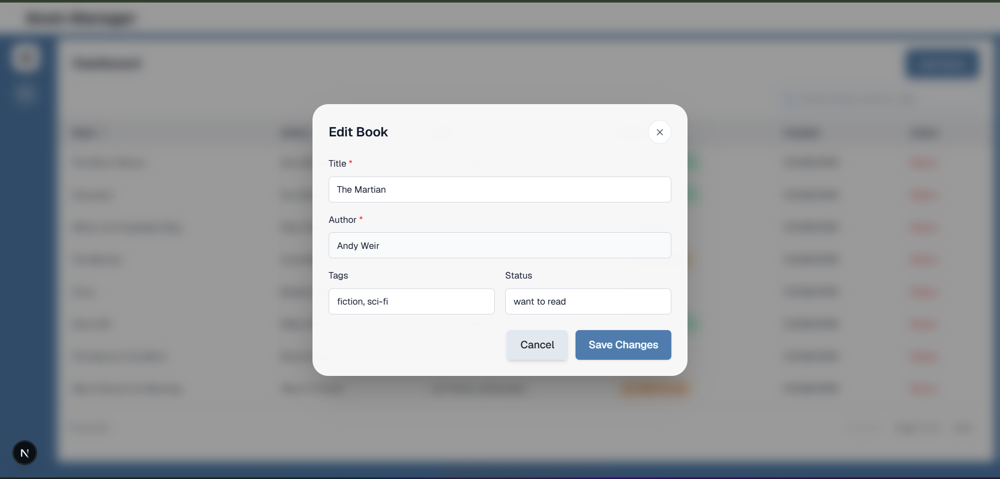

### Personal Book Manager 
<em>A modern personal library application to organize your reading life, track book progress, and manage your collection effortlessly.</em>


<p align="left">
  
  &nbsp;
  
  &nbsp;
  
  &nbsp;
  
  &nbsp;
  
  &nbsp;
  
</p>

<hr />

### 🚀 About the project

**Personal Book Manager** is a frontend-focused reading tracker designed to help users keep a personalized library of books they want to read, are currently reading, or have already completed. It offers a clean dashboard experience with structured book management and status tracking.

### ✨ Features

<table>
  <tr>
    <td valign="top">

- ✅ User registration and login flow
- ✅ Add, edit and delete books
- ✅ Track reading status: To Read, Reading, Read
- ✅ Organize books with custom tags
- ✅ Personalized dashboard overview

</td>
    <td valign="top">

- ✅ Search and filter books by status or tag
- ✅ Protected routes for authenticated users
- ✅ Responsive modern UI
- ✅ Secure API-based frontend integration
- ✅ Smooth notifications and interactions

</td>
  </tr>
</table>


### 🛠️ Tech Stack

| Frontend | State & Data | UI & Utilities |
|:--------:|:------------:|:--------------:|
| Next.js, React, TypeScript, Tailwind CSS | Redux Toolkit, React Query, Axios | Framer Motion, React Toastify, Lucide React |

### 📷 Screenshots

<p align="center">
  
  
  
</p>

### 🚀 Getting Started

<table>
  <tr>
    <td valign="top" width="40%">

#### Prerequisites

- **Node.js** (v18+)
- **npm** (v9+)
- **Backend API** running for auth and book operations

#### ⚙️ Environment Variables

Create a `.env.local` file in the project root and add:

```env
JWT_SECRET=your_secret_key
API_BASE_URL=http://localhost:3030
NEXT_PUBLIC_API_BASE_URL=http://localhost:3030
```

> 💡 Never commit your `.env.local` file.

</td>
    <td valign="top" width="60%">

#### Installation

1. Clone the repository

```bash
   git clone https://github.com/your-username/personal-book-manager.git
   cd personal-book-manager
```

2. Install dependencies

```bash
   npm install
```

3. Start the frontend

```bash
   npm run dev
```

4. Open the app in your browser

```bash
   http://localhost:3000
```

</td>
  </tr>
</table>

### 🔗 API Endpoints (Base URL: `NEXT_PUBLIC_API_BASE_URL`)

<table>
  <tr>
    <td valign="top" width="60%">

| Method | Endpoint | Description | Auth Required |
|:------:|----------|-------------|:-------------:|
| `POST` | `/auth/register` | Register a new user | No |
| `POST` | `/auth/login` | Login user | No |
| `GET` | `/books` | Get all books for the user | Yes |
| `POST` | `/books` | Add a new book | Yes |
| `PUT` | `/books/:id` | Update a book | Yes |
| `DELETE` | `/books/:id` | Delete a book | Yes |

</td>
    <td valign="top" width="40%">

#### 📁 Project Structure

```text
Personal_Book_Manager/
├── app/                  # App routes and layouts
├── components/           # Reusable UI components
├── features/             # Feature-specific modules
├── hooks/                # Custom hooks
├── service/              # API services and route config
├── store/               # Redux store and state logic
├── types/                # Shared TypeScript interfaces
├── public/               # Static assets
├── utils/                # Utility helpers
├── .env.example
├── .gitignore
├── package.json
├── next.config.ts
├── tsconfig.json
└── README.md
```

</td>
  </tr>
</table>

<table>
  <tr>
    <td valign="top" width="50%">

#### 👥 Contributing

Contributions are welcome! Feel free to open issues or submit pull requests for features, bug fixes, and UI improvements.

</td>
    <td valign="top" width="50%">

#### 📄 License

This project is licensed under the [MIT License](LICENSE).

</td>
  </tr>
</table>


Made with ❤️ by [Neel Samel](https://github.com/NEELSAMEL19)
